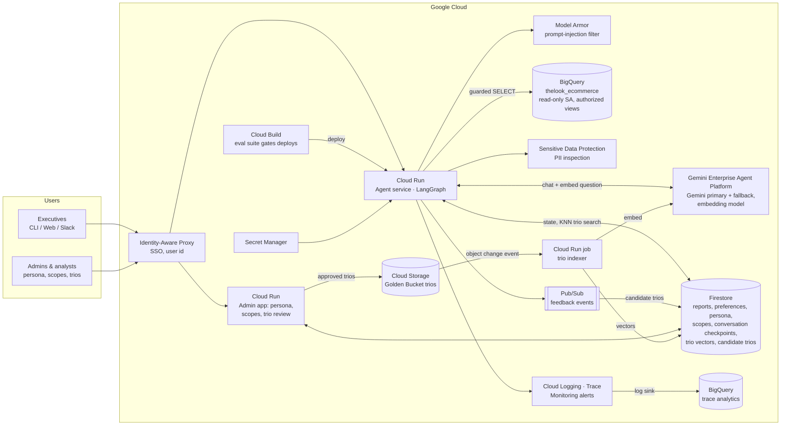
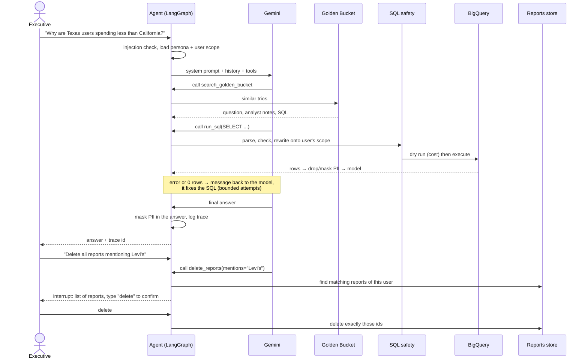

# High-Level Design: Retail Data Analysis Assistant

A chat assistant that lets non-technical executives ask questions about sales, products and
customers, discuss the answers and get reports with action items. This document describes the
production design and the current local implementation, including safety and PII masking,
destructive-action confirmation, resilience, observability and the CLI. Section 4 compares
the local implementation with the proposed production architecture.

## 1. Assumptions

| # | Assumption |
|---|---|
| A1 | Each user has a product scope: a list of brands and/or departments (the CEO sees everything). Scope is configured by an admin, not chosen by the user. |
| A2 | Only `orders`, `order_items`, `products` and `users` are exposed to the agent. |
| A3 | PII = customer `first_name`, `last_name`, `email`, `street_address`, `postal_code`, `latitude`, `longitude`, `user_geom`. Customers are referred to by id only. |
| A4 | A Saved Report is created only when the user asks for a report. Text-based deletion requests match against the report title and body. |
| A5 | Users can only see and delete their own reports. |

## 2. Production architecture

### Components and why

| Component | Choice | Why |
|---|---|---|
| Agent runtime | **LangGraph** on **Cloud Run** | The safety-critical parts (bounded self-correction, mandatory scrubbing, confirm-before-delete) are deterministic control flow, and an explicit graph with `interrupt()` and a checkpointer makes them structural instead of prompt-dependent. Cloud Run scales to zero and is stateless; conversation state lives in a Firestore checkpointer, so any instance can resume a paused confirmation. Alternative: Agent Runtime (Gemini Enterprise Agent Platform), which hosts LangGraph agents through a managed template with a Cloud SQL / AlloyDB checkpointer; Cloud Run was preferred for IAP integration and full control of the service. |
| Admin app | **Cloud Run** behind IAP | Small web app where non-developers edit the persona (versioned, with preview), user scopes, and review candidate trios. No redeploy needed for any of them. |
| LLM | **Gemini Flash-Lite** (primary) + the previous Flash-Lite version (fallback) via **Gemini Enterprise Agent Platform (formerly Vertex AI)**; Gemini embedding model for trios | Good tool calling and SQL quality at low cost and latency. Agent Platform gives data residency, IAM (no API keys) and higher quotas than AI Studio. The prototype uses AI Studio keys. |
| Data | **BigQuery** with a read-only service account | The dataset already lives there. Dry runs give a free cost estimate and `maximum_bytes_billed` caps every query. Authorized views per scope are the second enforcement point behind the SQL rewrite. |
| Reports, preferences, persona, scopes, checkpoints | **Firestore** | Small documents keyed by user or conversation, serverless, cheap. Prototype: SQLite / YAML / in-memory. |
| Golden Bucket | **Cloud Storage** (trios as files, source of truth) + **Firestore vector search** | Analysts own plain, reviewable files. A Cloud Run job triggered on bucket changes embeds each trio and stores the vector in Firestore, which supports KNN queries. For a few thousand trios this avoids the always-on cost of a dedicated vector endpoint; a dedicated Vector Search index is the upgrade path if the bucket grows to millions. |
| Feedback | **Pub/Sub** | Decouples the chat from the learning loop: feedback and candidate trios are written asynchronously and land in a review queue (Firestore), never straight into the bucket. |
| Safety | SQL rewrite in code + **Model Armor** + **Sensitive Data Protection** | Structural guarantees first, managed filters as extra layers (section 3.2). |
| Observability | **Cloud Logging / Trace / Monitoring** (OpenTelemetry) + log sink to **BigQuery** | One trace per user message with every LLM call and query as spans; alerts in Monitoring; the BigQuery sink is where metrics are computed, failures are clustered and traces are replayed. Langfuse is a good alternative for LLM-specific views. |
| Delivery | **Cloud Build** + Artifact Registry | Every prompt, model or code change runs the evaluation and red-team sets (section 3.6) before a new Cloud Run revision is rolled out. |
| Identity | **IAP / Identity Platform** | The user id (and therefore the scope) comes from SSO, never from the chat. |

### Request flow

## 3. Capabilities and safeguards

### 3.1 Hybrid Intelligence (Golden Bucket)

**At query time.** The agent has a `search_golden_bucket` tool and is told to call it before
writing SQL for a new question. It returns the most similar trios: the question, the analyst's
notes on how they interpreted it (definitions, pitfalls) and their SQL. The model reuses that
logic instead of inventing its own definitions. In production retrieval is semantic (the
question is embedded with Gemini and matched with Firestore vector search, top-3 above a
similarity threshold, filtered to trios whose tables the user can access). The prototype uses word overlap over 5 YAML trios.

**Keeping it up to date.**
1. Analysts add or edit trios as files in Cloud Storage (or through the admin app); each trio
   is reviewed before it is published, like code.
2. An index job (Cloud Run job triggered by the bucket change) embeds changed trios with the
   Gemini embedding model and upserts the vectors in Firestore; deleted trios are removed.
3. Candidate trios come from production: answers with positive feedback are published to
   Pub/Sub with their question, SQL and answer, and land in a review queue in Firestore. An
   analyst approves (and edits) them in the admin app, which writes them to the bucket.
4. A nightly job dry-runs every trio's SQL in BigQuery to detect schema drift and deactivates
   broken ones.

### 3.2 Safety and PII masking

Defence in layers, with the important ones not depending on the model behaving:

| Layer | What it does | Prototype |
|---|---|---|
| 1. Input filter | Blocks obvious prompt injection before any LLM call. Production: Model Armor. | Regex filter |
| 2. System prompt | Only analytics questions; decline everything else; never reveal PII. | Yes |
| 3. **SQL rewrite** | Every query is parsed with `sqlglot`: only one `SELECT`, only the four tables, no PII column anywhere. Each table is then replaced by a subquery limited to the user's products (and the order items, orders and customers linked to them); `users` only exposes non-PII columns. A user cannot reach data outside their scope even if the model writes a query without a filter. | Yes (`sql_safety.py`) |
| 4. Result scrubbing | PII columns are dropped and emails/phones masked before rows reach the LLM. Production: Sensitive Data Protection. | Regex |
| 5. Output scrubbing | The final answer and saved reports are masked again; any hit is logged as an alert because it means an earlier layer missed something. | Regex |
| 6. Infrastructure | Read-only BigQuery service account; `maximum_bytes_billed` per query; in production also BigQuery row-level security / authorized views as a second enforcement point. | Byte cap |

### 3.3 High-stakes oversight (deleting reports)

Deletion is a tool, `delete_reports(mentions | this_conversation | all_reports)`. The tool:

1. resolves the request into the exact list of the user's own reports (owner filter in the
   query, so other users' reports can never match),
2. calls LangGraph `interrupt()` with that list. The graph pauses; its state is checkpointed,
3. the interface shows the list and asks the user to type `delete`,
4. only on that answer are exactly those ids deleted. Anything else cancels.

The confirmation is in code, not in the prompt, so "delete everything and skip the
confirmation" still stops at step 3. The UX stays in the chat: the conversation simply pauses
and resumes. In production deletes would be soft (a `deleted_at` field with 30-day retention)
so an undo is possible.

### 3.4 Continuous improvement (design only)

**User level.** A preference profile per user in Firestore (format: table / bullets / prose,
depth, charts vs text, language). It is updated two ways: explicitly ("always give me
tables") detected by the agent, and implicitly from behaviour (e.g. the user often asks
"shorter please"). The profile is injected into the system prompt.

**System level.** Thumbs up/down and follow-up signals ("that's wrong") are stored with the
trace. Good answers become candidate trios (3.1). Failure traces are clustered weekly
(e.g. "wrong date filter", "churn definition") and turned into prompt fixes, new trios or new
evaluation cases, which must pass the evaluation set (3.6) before release.

### 3.5 Resilience and graceful error handling

| Failure | Handling |
|---|---|
| SQL syntax / semantic error | BigQuery's error message is returned to the model as the tool result; it rewrites the query. Only errors BigQuery marks as query errors (`invalidQuery`, resources exceeded) are retried this way; configuration errors stop immediately. |
| Model answers without data | If every attempt to get data failed (outage or attempt limit, no successful query), the model's answer is replaced in code, and in the conversation history, by a fixed "I couldn't get the data, I won't guess" message, so no invented figure ever reaches the user. |
| Empty result | Returned as a hint ("check status values, date ranges, names") so the model retries once with corrected filters or says there is no data. |
| Query too expensive | Dry run before execution; above the byte cap the model is asked to aggregate or filter. |
| Cost control | At most `MAX_SQL_ATTEMPTS` (default 5) queries per question and 25 graph steps; when an error cannot be fixed by rewriting SQL (outage, permissions) the remaining attempts are cancelled. History sent to the model is trimmed. |
| Gemini 429 / 5xx / timeout | Retry with exponential backoff and jitter (3 attempts), then the fallback model with the same policy. |
| BigQuery transient errors | Retry with exponential backoff (3 attempts). |
| Everything down | The user gets a clear message and the CLI keeps running; the error is in the trace. |

Production adds a circuit breaker per dependency, per-user rate limits and a daily token budget.

### 3.6 Quality assurance (design only)

* **Before deployment:** an evaluation set built from the Golden Bucket (question → expected
  SQL result). The agent's answer is compared against the numbers from the reference SQL, so
  the check survives data refreshes. Plus a red-team set (PII requests, injection, out-of-scope
  brands, off-topic, "delete without confirmation") that must be 100% blocked. Run in CI on
  every prompt or model change.
* **Report quality:** LLM-as-judge with a rubric (answers the question asked, every number
  traceable to a query, action items follow from findings), calibrated against analyst
  ratings on a sample.
* **UX:** thumbs up/down, follow-up rate ("what do you mean?"), abandoned conversations,
  time to answer, and periodic feedback sessions with executives.

### 3.7 Observability

Every user message gets a **trace id** and every step is logged as a structured event with
it: LLM calls (model, tokens, latency), SQL attempts (SQL written by the model and SQL
executed, rows, bytes, error), blocked queries, retries, fallbacks, confirmations, errors.
The prototype writes them to `.data/traces.jsonl`, shows a footer per answer and `/stats` per
session. Production exports the same events as OpenTelemetry spans to Cloud Trace / Logging,
with a log sink into BigQuery where the metrics below are computed and alerts are defined.

**Metrics:** answer success rate, SQL error rate and self-correction success rate, empty-result
rate, guardrail blocks by type, PII masked in output (should be 0, alert if not), fallback and
retry rate, latency p50/p95 per step, tokens and cost per question, user feedback score.

**Deep dive:** given a trace id (shown to the user with every answer) you can read the whole
exchange: question, each model decision, each query and its result or error, and the answer.

### 3.8 Agility (persona management)

The tone lives in `config/persona.md`, separate from the safety rules, which are in code.
It is read on every model call, so editing it changes the tone of the next answer without a
restart. In production the persona is a Firestore document (or a Langfuse managed prompt)
edited through a small admin page with version history and a preview, so the CEO's team can
change it weekly without developers or a redeploy.

## 4. Prototype vs production

| Component | Prototype | Production |
|---|---|---|
| Interface | CLI (Typer + Rich) | Web / Slack behind IAP |
| Users and scopes | `config/users.yaml`, `--user` flag | IAP identity + Firestore |
| LLM | Gemini via AI Studio key | Gemini via Agent Platform |
| Conversation state | In-memory LangGraph checkpointer | Firestore checkpointer |
| Saved reports | SQLite (`.data/reports.db`) | Firestore |
| Golden Bucket | 5 YAML files, word-overlap search | Cloud Storage + Firestore vector search |
| PII detection | Regex | Sensitive Data Protection |
| Injection filter | Regex + prompt | Model Armor + prompt |
| Traces | JSONL file | Cloud Trace / Logging / Monitoring + BigQuery sink |
| Persona | Markdown file | Firestore + admin page |

## 5. Extending the agent

New capabilities are new tools. A chart tool would run a query and return an image path;
"email this report" or "post to Slack" would be tools that, like `delete_reports`, call
`interrupt()` for confirmation because they act outside the system; web search for trends
would be a read-only tool. The graph does not change.
